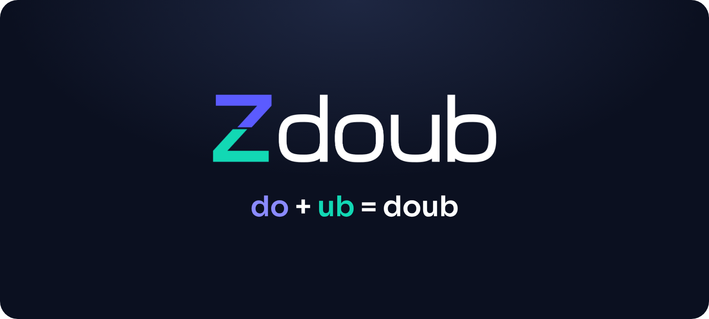

  

A Zdoub nasceu de um olhar. Inicialmente criada como **DOUB Photos** — um projeto de fotografia que registrava momentos e detalhes do cotidiano —, a marca carregava no próprio nome a união do casal: o encontro das últimas sílabas de duas histórias que compartilham o mesmo entusiasmo por tecnologia.

Embora o projeto de fotografia tenha cumprido seu ciclo, o propósito da DOUB continuou vivo e evoluiu. Dessa paixão combinada por tecnologia e eficiência, nasceu a **Zdoub**: um conjunto de aplicações de rotina diária, desenvolvido para simplificar e organizar a vida de um jovem casal.

Hoje, a Zdoub está na fronteira entre a gestão de rotinas (cardápios, finanças, mídias e tarefas) e a automação residencial física, preparando o terreno para a integração completa com o hardware da casa.

A Zdoub é movida pela curiosidade e pelo desejo constante de criar algo maior. Seja o embrião de uma futura startup de automação, a criação de novos aplicativos de utilidade diária ou até a exploração do universo de desenvolvimento de games — uma paixão geek que mantemos viva —, a marca carrega um futuro totalmente aberto e cheio de possibilidades.

---

| 🟣 Começo | 🟣 Hoje | 🟢 Futuro |
| :-- | :-- | :-- |
| **DOUB Photos** | **Zdoub** | **Próximos passos** |
| Um projeto de fotografia do cotidiano. Foi onde a vontade de criar juntos começou. | A marca cresceu e virou uma casa de aplicações para o dia a dia, caminhando para a automação residencial. | Uma startup de automação, novos apps de utilidade diária e o desenvolvimento de games. |

---

  🌐 <a href="https://douboficial.com">douboficial.com</a> · ✉️ contato@douboficial.com 
  Duas partes. Um sistema.

